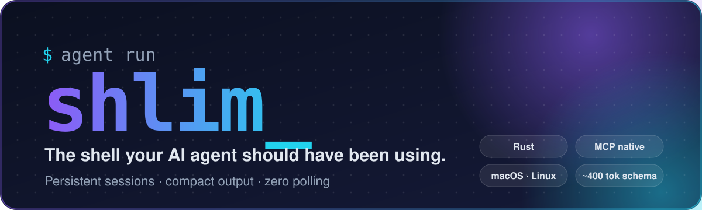
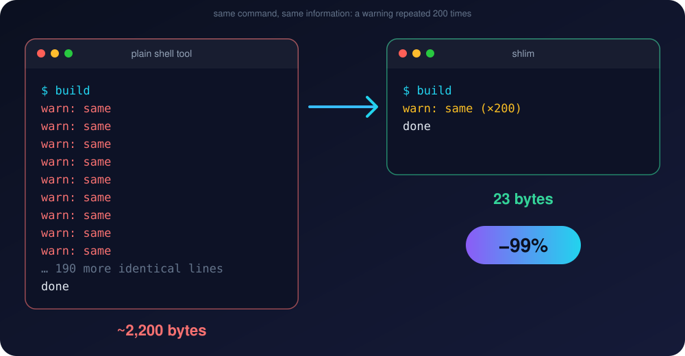
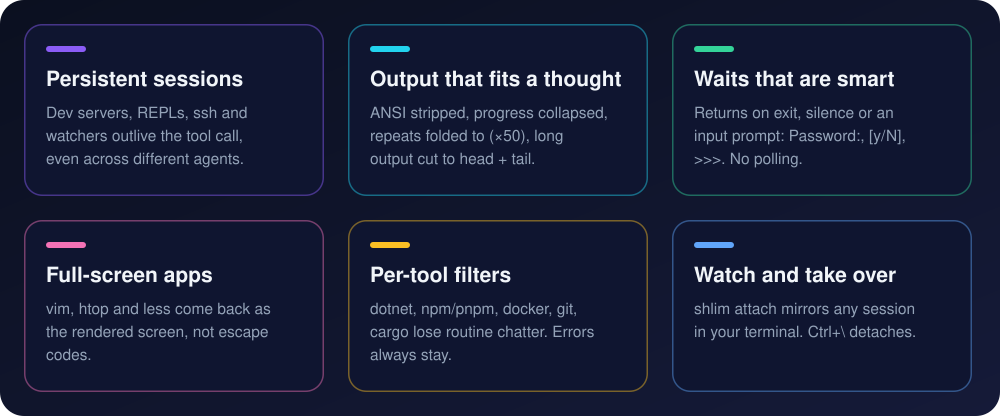
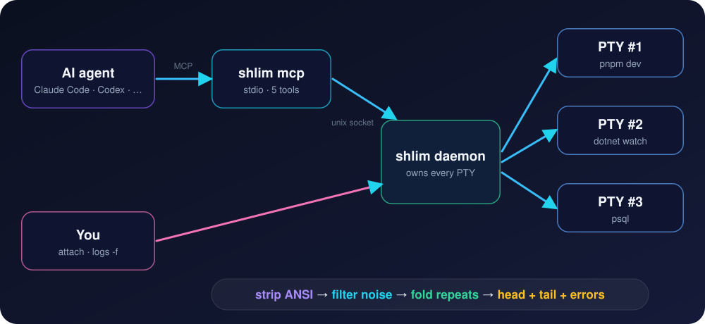

<p align="center">
  
</p>

<p align="center">
  <a href="#-quick-start"><b>Quick start</b></a> &nbsp;·&nbsp;
  <a href="#-the-five-tools"><b>Tools</b></a> &nbsp;·&nbsp;
  <a href="#-how-it-works"><b>How it works</b></a> &nbsp;·&nbsp;
  <a href="#-cli"><b>CLI</b></a> &nbsp;·&nbsp;
  <a href="#-configuration"><b>Config</b></a>
</p>

<p align="center">
  <b>shlim</b> gives AI coding agents a shell that <b>remembers</b> and <b>doesn't ramble</b>:<br>
  real PTY sessions owned by a background daemon, and output trimmed to what the agent needs to decide its next move.<br>
  One small Rust binary. Works with Claude Code, Codex, OpenCode, Cursor, and anything that speaks <a href="https://modelcontextprotocol.io">MCP</a>.
</p>

<br>

## 😤 The problem

A plain shell tool is built for humans who read a screen once. Agents pay for **every line, on every later turn**.

- `npm run dev` hangs the call, or the server dies when the call ends.
- `dotnet build`, `pnpm install` and `docker compose up` dump hundreds of lines of restore chatter, progress bars and duplicated warnings into the context window.
- `ssh`, `psql`, a REPL or a `[y/N]` prompt leaves the agent stuck, timing out or polling in a loop.
- Need that dev server again later? It starts a second one.

## ✨ The fix

<p align="center">
  
</p>

<sub>Measured with `shlim run` on a loop that prints one warning 200 times. Your savings depend on how noisy your commands are; `shlim stats` reports your real numbers.</sub>

<br>

<p align="center">
  
</p>

<br>

## 🚀 Quick start

**1 · Install** (macOS and Linux · no Rust, no Node)

```bash
brew install jgilbertcastro/shlim/shlim
```

Ready-made binary for macOS (Apple Silicon / Intel) and Linux (x86_64 / ARM64), installed by [Homebrew](https://brew.sh).

<details>
<summary>No Homebrew? Use the install script or build from source</summary>

<br>

```bash
curl -fsSL https://raw.githubusercontent.com/jgilbertcastro/shlim/main/install.sh | sh
```

It downloads the same binary, checks its SHA-256 and puts it in `~/.local/bin`. Pre-releases (`-rc` tags) are skipped by default; to install one, add `SHLIM_VERSION=v0.0.2-rc1` before `sh`. To build from source instead: `cargo install --path .`

</details>

**2 · Connect your agent** (pick one, or both)

<table>
<tr>
<td width="50%" valign="top">

**Claude Code**

```bash
shlim install claude
```

Registers shlim as an MCP server (`claude mcp add`) and adds the instruction below to `~/.claude/CLAUDE.md`.

</td>
<td width="50%" valign="top">

**Codex**

```bash
shlim install codex
```

Adds `[mcp_servers.shlim]` to `~/.codex/config.toml` and the instruction below to `~/.codex/AGENTS.md`.

</td>
</tr>
</table>

Any other MCP client (OpenCode, Cursor…) works too: point it at the command `shlim mcp` over stdio.

**3 · Restart the agent and verify**

```bash
shlim doctor
```

```text
ok   daemon running (v0.1.0, socket ~/.shlim/shlim.sock)
ok   registered with Claude Code (~/.claude.json)
ok   CLAUDE.md tells the agent to prefer shlim (~/.claude/CLAUDE.md)
```

### 📝 The instruction (automatic or manual)

Registering shlim only makes its tools **available**. Agents also keep their own built-in shell, and often pick it anyway. So `install` adds a short note to the agent's memory file (`CLAUDE.md` for Claude Code, `AGENTS.md` for Codex) telling it to use shlim first:

```markdown
## Shell commands
Run shell commands with the shlim MCP tools (`run`, `send`, `read`) instead of the built-in shell: output is compacted and sessions persist (dev servers, REPLs, ssh).
Start long-running programs with `run`, then use `read` (with `wait`, `grep` or `mode=all`) rather than re-running a command to see more output.
```

| You want | Do this |
|:--|:--|
| **Automatic** (default) | Nothing. `shlim install …` writes the note once and never duplicates it. |
| **Manual** | `shlim install claude --no-note`, then paste the snippet above into `CLAUDE.md` / `AGENTS.md` yourself. |
| **Only for one project** | Use `--no-note` and paste the snippet into that project's `CLAUDE.md` / `AGENTS.md` instead of the global one. |

> If `shlim list` stays empty after a working session, the agent never used shlim. Check that the instruction is in place with `shlim doctor`.

<details>
<summary><b>Upgrading</b></summary>

<br>

The daemon keeps running the binary it started with, so stop it after installing a new version. The next tool call starts a fresh one.

```bash
brew upgrade shlim && shlim stop
```

(With the install script, run it again, then `shlim stop`.)

`shlim stop` also ends every running session.

</details>

<br>

## 🧰 The five tools

That is the entire API the agent sees (about **400 tokens** of schema).

| Tool | What it does |
|:--|:--|
| **`run`** `{cmd, cwd?, timeout?, keep?}` | Start a command in a new session. Returns when it exits, goes idle, or asks for input. `keep: true` exempts a quiet server or tunnel from idle cleanup. |
| **`send`** `{id, text?, keys?, submit?}` | Type into a session (`keys`: `enter` `tab` `esc` arrows `ctrl+c` …) and return the reply. |
| **`read`** `{id, wait?, mode?, grep?, from?, limit?}` | New output since the last read. `wait`: `exit`, `quiet` or a regex. `mode`: `screen` or `all`. |
| **`kill`** `{id}` | Stop a session. |
| **`list`** | List sessions. |

```text
run   {cmd: "pnpm dev"}                    →  [#3 running · 4.1s]  ready on http://localhost:3000
run   {cmd: "pnpm test"}                   →  Tests  42 passed
read  {id: 3, grep: "error"}               →  only the matching lines, from the server that is still running
send  {id: 5, text: "yes", submit: true}  →  answers a [y/N] prompt inside a live session
```

A reply with **no `[#id …]` header** means the command finished with exit 0. Nothing to decode when nothing went wrong. Wrong argument names (`command`, `session_id`…) are corrected automatically; anything else gets an error that teaches the right call.

<br>

## ⚙️ How it works

<p align="center">
  
</p>

1. The **daemon** owns every PTY, so a session survives the agent that started it.
2. Raw bytes feed two views: a **plain-text line buffer** (ANSI removed, redraws collapsed) and a **`vt100` screen** for full-screen programs.
3. On each reply, **per-tool filters** drop routine lines, **duplicates fold**, and anything over budget keeps its **head, tail and error lines** with a pointer to the rest. Errors are **grouped by kind**: 35 copies of the same mistake in 35 files read as `error CS0029: … (+34 similar)`, not 35 lines.
4. **Background problems reach the agent.** Agents cannot be woken up, so when a session the agent is not looking at starts failing, the next shlim reply carries a one-line alert, once:
   ```text
   ⚠ #3 `pnpm dev` 2 new error lines: src/a.ts(3,1): error TS2304: … (read id=3 grep=error)
   ```
5. The full raw output of every session stays on disk in `~/.shlim/logs/`. Nothing is lost, only not sent.

### 🧹 Noise filters

Only low-value lines are removed. Failures, warnings and results are never touched: a line that looks like an error is kept even if a rule would drop it, and tests replay real `dotnet`, `pnpm`, `cargo`, `docker` and `git` output to prove no error or warning is lost. `read mode=all` still shows everything.

| Command family | Dropped | Always kept |
|:--|:--|:--|
| `dotnet build · test · restore · run` | restore chatter, `proj -> bin.dll`, per-test `Passed …` | errors, warnings, `Failed …`, the `Passed!` / `Failed!` summary |
| `npm · pnpm · yarn · bun` install | `Progress: resolved …`, `+++` bars, lockfile notices | errors, real warnings |
| `docker build · up · pull` | `#5 DONE`, `CACHED`, layer pull progress | build errors, service logs |
| `git clone · fetch · pull · push` | counting / compressing / receiving progress | refs, errors |
| `cargo build · test · check · run` | one line per crate → `(37 crate steps, last: serde)` | warnings, errors, `Finished` |

<br>

## 💻 CLI

```text
shlim run <command…>          run a command exactly as the agent would, print the compact output
shlim list                    sessions, with start time, read→sent sizes and unread output
shlim attach <id>             watch and type into a session  (Ctrl+\ detaches, the agent keeps going)
shlim logs <id> [-f]          plain output of a session; -f follows until it exits
shlim read <id> [screen|all]
shlim kill <id>
shlim stats                   what shlim actually saved
shlim doctor                  check daemon, registration and the agent instruction
shlim install <claude|codex> [--no-note]
shlim stop                    stop the daemon and every session
```

### 📊 Honest numbers

`shlim stats` compares what a plain shell would have returned for the output the agent **actually read** with what shlim sent. Logs nobody read (a dev server running in the background) are reported separately and never counted as savings.

```text
since 2026-11-18 09:02:11 (daemon up 5h) · now 2026-11-18 14:12:38
read by agent:   22.7k (~5814 tokens, what a plain shell would have sent)
sent to agent:   7.4k  (~1887 tokens)
saved:           ~3926 tokens (68%)
never read:      0B (not counted; 0B of it from running sessions)
tokens are estimated as bytes/4
```

<sub>Illustrative output. Token counts are a bytes ÷ 4 estimate, not a tokenizer.</sub>

<br>

## 🔧 Configuration

| Variable | Default | Meaning |
|:--|:--|:--|
| `SHLIM_HOME` | `~/.shlim` | Socket, `daemon.log` and per-session raw logs (`logs/`). |
| `SHLIM_IDLE_MINUTES` | `30` | Stop sessions nobody used, nobody is watching and that print nothing. Sessions started with `keep: true` are never stopped. |
| `SHLIM_MAX_SESSIONS` | `64` | Maximum sessions running at once. |
| `SHLIM_LOG_DAYS` | `7` | Delete raw logs older than this when the daemon starts. |

State lives in a `0700` directory and the socket is owner-only. Each session runs with the environment of the client that started it (so Claude Code and Codex each get their own `PATH` and variables), and pagers are disabled (`PAGER=cat`) so nothing traps the agent in an interactive screen.

<details>
<summary><b>Project layout</b></summary>

<br>

```text
src/
├── main.rs      CLI, install, doctor, logs
├── mcp.rs       MCP server over stdio · argument normalisation
├── daemon.rs    session owner · Unix socket protocol · stats · reaper
├── session.rs   one PTY · smart waits · prompt detection · accounting
├── text.rs      ANSI → plain lines · folding · head/tail compaction
├── noise.rs     per-tool filters
└── client.rs    talks to (and starts) the daemon
```

```bash
cargo test     # compaction, filters (tests/fixtures hold real tool output), real PTY sessions, install
```

</details>

<br>

## 🗺️ Status

Early (`0.1.0`), and honest about it.

- ✅ macOS and Linux, installed with `brew install` or one `curl` line (prebuilt binaries, no toolchain)
- ✅ One-command registration for Claude Code and Codex; any MCP client works by running `shlim mcp`
- 🚧 Windows (ConPTY + named pipe) is planned
- 🚧 Token counts are estimated, not tokenizer-exact
- 🚧 Filters are tuned on synthetic output; real-world patterns will need tuning. PRs welcome

<br>

<p align="center">
  <sub>MIT licensed · see <a href="LICENSE">LICENSE</a></sub>
</p>

<p align="center">
  <b>Stop paying for noise. Give your agent a shell that remembers.</b>
</p>
